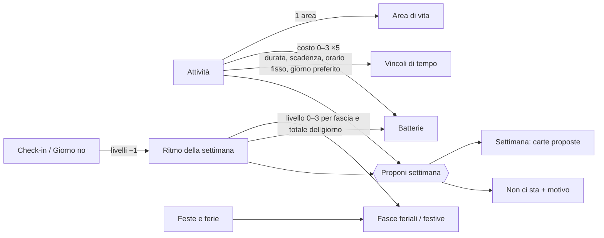

# Priority Planner · piano

Stato al 25/11/2026, versione 0.6.0. Approvati i 20 punti della revisione del piano (rev. 3, 09/11/2026) e i 12 punti delle Fasi 4 e 5 (`docs/revisione-fasi-4-5.html`, rev. 3). La roadmap visiva è in `docs/roadmap/`; la guida tecnica per chi sviluppa è `docs/sviluppo.md`.

**Adesso:** prova sul tablet delle Fasi 1–4; poi Fase 5 (T6), a partire dal prototipo dei file su Android. Le card con le checklist sono in `TODO.md`.

## Stato del lavoro

| Fatto | # | Fase | Cosa vedi funzionare alla fine | Punti | Tempo indicativo |
|---|---|---|---|---|---|
| ✅ | T1 | 0 | L'app vuota si installa su tablet e Windows, con 4 stili in chiaro e scuro e l'aggiornamento automatico | D1, D2, D5 | ~2 h |
| 🟡 | T2 | 1 | Crei attività con area, batterie e vincoli; vedi «Tutte le attività» con il filtro | A1, A2, C1, C3 | ~1,5 h |
| 🟡 | T3 | 2 | «Il mio ritmo»: pennello, fasce, feste e ferie, ritmi salvati | B1, B2, B3, B6 | ~1,5 h |
| 🟡 | T4 | 3 | Vista Settimana + «Proponi settimana», con attività lunghe e test | A3, B4, B7, B8 | ~3 h |
| 🟡 | T5 | 4 | Vista Oggi, check-in, «Giorno no» | B5, C1 | ~1,5 h |
| ⬜ | T6 | 5 | Prototipo file su Android, poi Importa / Esporta, provato tra tablet e telefono | D4 | ~2 h |

🟡 = scritta (0.3.0–0.6.0), in attesa della prova sul tablet. I tempi sono stime del lavoro dell'agente. Ogni fase finisce con un APK provato sul tablet e con l'installer Windows.

Già presente nel codice (versioni 0.1.0–0.6.0):
- Progetto Tauri 2 + Svelte + TypeScript, con `versioni.txt`; 4 stili in chiaro e scuro.
- Attività con modelli, «Tutte le attività» con filtro, salvataggio in `dati.json`.
- Il mio ritmo (livelli, feste e ferie, fasce orarie, regole), «Proponi settimana» con test, vista Oggi con check-in e Giorno no.
- Aggiornamento automatico da GitHub e script `build-windows.ps1`, `build-android-alt.ps1`, `release.ps1`.

## L'idea in una riga

Ogni attività consuma energia da 5 **batterie**. Ogni giorno ha un livello per batteria in ogni fascia oraria. Il bottone **«Proponi settimana»** mette ogni attività dove le batterie bastano.

## Il modello (A1–A3)

| Concetto | Valori | A cosa serve |
|---|---|---|
| **Area** (1 per attività) | 💼 Lavoro, 👪 Famiglia, 🧡 Amici, 🩺 Salute, 🏠 Casa, 🌱 Me stessa | Colore e icona della carta; alternare le aree nella settimana; filtro Lavoro / Personale |
| **Batterie** (costo 0–3 ciascuna) | 🧠 Mentale, ❤️‍🩹 Emotiva, 💬 Sociale, 🎧 Sensoriale, 💪 Fisica | Decidono **dove** entra un'attività. Nomi e icone si possono cambiare |
| **Vincoli di tempo** | Durata, scadenza, orario fisso, giorno preferito | Decidono **quando** può entrare |

**Cuscinetto** (A3): dopo un'attività con almeno un costo 3, l'app lascia 15 minuti liberi. Si sceglie 0, 15 o 30 minuti.

## Fasce e settimana (B1, B2)

7 giorni. Due modelli di fasce, modificabili nelle impostazioni:

| Giorno | Fasce predefinite |
|---|---|
| Feriale (13) | 7–9, poi ogni ora da 9 a 18, poi 18–20, 20–22, 22–0 |
| Festivo (9) | 6–8, 8–10, 10–12, 12–14, 14:30–16, 16–18, 18–20:30, 21–0, 0–3:30 |

- I buchi 14–14:30 e 20:30–21 sono pause: l'app non ci mette niente.
- La fascia 0–3:30 esiste solo se anche il giorno dopo è festivo: c'è il sabato, non la domenica.
- Sabato e domenica sono festivi. Feste e ferie si aggiungono nell'elenco «Feste e ferie» (data o intervallo, nome facoltativo). Nessuna festa precaricata.

## Il mio ritmo (B3, B6)

- Per ogni fascia e batteria un livello da 0 a 3, colorato con un pennello: scegli la batteria, clicchi le caselle.
- Il **totale del giorno** per batteria vale il 40% della somma delle fasce, ed è modificabile a mano.
- Si salvano più ritmi con un nome (es. «Normale», «Settimana pesante»). Per ogni settimana scegli quale usare. Un ritmo nuovo parte da una copia di uno esistente.

## Il bottone «Proponi settimana» (B4, B7, B8)

1. Mette prima gli impegni a orario fisso e le attività bloccate.
2. Ordina le altre: prima la scadenza più vicina, poi il costo totale più alto.
3. Una fascia accetta un'attività solo se bastano livello, totale del giorno e tempo libero.
4. Al massimo 1 attività pesante emotiva o sociale al giorno (numero modificabile).
5. Tra le fasce valide sceglie quella con più energia libera. Preferisce il giorno preferito e alterna le aree.
6. Ciò che non entra va in **«Non ci sta»**, con il motivo (es. «gio–ven: 💪 finita»).

Attività lunghe (B7):
- Un'attività breve entra in una fascia se c'è tempo libero; più attività brevi possono stare nella stessa fascia.
- Un'attività lunga occupa fasce consecutive e vuote; una pausa interrompe la sequenza.
- Ogni fascia occupata deve avere il livello sufficiente; il costo conta una volta sola nel totale del giorno.
- Nella griglia la carta sta nella prima fascia; le fasce dopo mostrano «↳» con il nome.

Le proposte hanno il bordo tratteggiato. Clic su una carta = la blocchi (🔒, bordo pieno): resta ferma quando chiedi una nuova proposta. Ogni carta dice in una riga «perché qui». Con gli stessi dati la proposta è sempre la stessa.

A fine settimana (B8) le attività non fatte e quelle in «Non ci sta» tornano in «Da pianificare». L'app non cancella mai niente da sola; un contatore neutro dice quante sono.

## Giorno no e check-in (B5)

Decisioni di dettaglio in `docs/revisione-fasi-4-5.html` (A1–A4, rev. 3). Idea per dopo la Fase 5: un tasto «Condividi» per mandare il file esportato direttamente a Telegram o Discord (Q1).

- **Check-in** (A4, rev. 3): le faccine 🙂 😐 😣 stanno sempre in Oggi. Nessuna scelta = 🙂; nessuna richiesta all'avvio. Si cambiano quando vuoi, tutto il giorno, in meglio o in peggio. 😐 = −1 su 🧠 e ❤️‍🩹; 😣 Giorno no = −1 su tutte le batterie. Una scelta per data, salvata in `dati.json`.
- **Calo per data** (A1): il check-in scrive `cali[data]`. `giorniPiano` lo sottrae da livelli e totale di quel giorno, mai sotto 0. Il ritmo non cambia.
- **Ricalcolo a ogni cambio** (A2, A4), con le regole normali del bottone, senza priorità speciali (Q3):
  - tocca solo quello che deve ancora arrivare: attività di oggi non fatte che iniziano dopo adesso, più i giorni dopo fino a domenica. Fatte, in corso e passate restano;
  - per oggi il tempo libero parte dall'ora attuale (novità nel pianificatore);
  - passando a 😣 o lasciandolo: si sbloccano le attività di oggi ancora da arrivare (non gli orari fissi), poi ricalcolo;
  - passando a 😐 o a 🙂 senza toccare 😣: ricalcolo delle sole proposte; le bloccate restano.
- **Attività spostate** (A3): nessun bordo giallo. Dopo il ricalcolo sono proposte, quindi tratteggiate; le blocchi di nuovo con 🔒.
- **Annullare** (A4): tornare a 🙂 ricalcola di nuovo. Le attività non tornano per forza dove erano; non c'è copia della settimana.

## Le 6 schermate (C1)

1. **Settimana**: la vista principale, griglia di 7 giorni per fasce.
2. **Oggi** (B1, B2):
   - l'app si apre come sempre sull'ultima schermata; in cima a Oggi una riga con 🙂 😐 😣, sempre modificabile;
   - **Adesso** = l'attività non fatta il cui posto contiene l'ora attuale (se sono due, la prima che inizia). Nessuna: «Pausa»;
   - **Dopo** = la prossima non fatta di oggi, con «tra 40 min». Dopo l'ultima: «Per oggi basta» e quante ne hai fatte, senza contare le mancate;
   - ogni carta: titolo, orario, icone dei costi, bottone «Fatta». Le proposte tratteggiate compaiono come le altre. L'ora si aggiorna ogni minuto.
3. **Nuova attività**: titolo, area, durata e 5 cursori. I modelli salvati compilano i campi.
4. **Il mio ritmo**: la griglia da colorare con il pennello.
5. **Check-in**: 3 faccine nella riga in cima a Oggi, modificabili tutto il giorno.
6. **Tutte le attività**: elenco completo con stato (in settimana, da pianificare, non ci sta, fatta), scadenza, filtro e ricerca.

**Filtro** (C3): Tutte · 💼 Lavoro · 🏡 Personale (tutte le aree tranne Lavoro). Vale in Settimana, Oggi e Tutte le attività. È solo visivo: le attività nascoste occupano comunque la fascia, che mostra un segno grigio.

## Scelte visive (C2, D5)

- Solo icone, senza il nome accanto. Il nome compare tenendo premuta l'icona o passandoci sopra, e in una sola legenda.
- Poco testo. Niente rosso da «fallimento»: «Non ci sta» usa toni neutri.
- Nessuna animazione brusca, nessuna notifica insistente.
- Ogni batteria ha un colore suo. Colori e icone restano uguali in tutti e 4 gli stili.

| Stile | In questa app |
|---|---|
| Liquid glass (di partenza) | Pannelli di vetro su uno sfondo di luce sfumata; le icone della legenda sono gocce d'acqua colorata |
| Neumorfismo | Fasce incavate, carte in rilievo, superficie unica senza bordi |
| Skeuomorfismo | Copertina in pelle cucita; la settimana è una pagina d'agenda di carta con doppio margine rosso, rilegatura tra venerdì e sabato, orari a matita; bottoni in ceramica e ottone |
| Claymorphism | Pasta da modellare: sfondo azzurro pastello, riquadri giallo burro, accenti rosa fragola; forme gonfie e opache, al massimo su due livelli |

## Tecnica (D1–D4)

- **App**: Tauri 2 + Svelte + TypeScript. Obiettivo principale il tablet Android in orizzontale; Windows a ogni versione; funziona anche sul telefono.
- **Dati**: file JSON sul dispositivo. Offline, senza account.
- **Pianificatore**: modulo TypeScript separato, con test.
- **Calendari esterni**: nessuno per ora (D3). Gli impegni fissi si scrivono nell'app.
- **Sincronizzazione** (D4; dettagli C1–C6 in `docs/revisione-fasi-4-5.html`):
  - **Esporta**: su Windows la finestra «Salva» normale; su Android la finestra «Salva come» di Android, con un comando Kotlin nostro che scrive tramite il `ContentResolver`. I plugin ufficiali `dialog` + `fs` hanno un bug aperto che crea file vuoti ([plugins-workspace #3356](https://github.com/tauri-apps/plugins-workspace/issues/3356)). **Prima della Fase 5 serve un prototipo sul tablet.**
  - **Importa**: finestra «Apri file» (`dialog`); se la lettura dal plugin non funziona su Android, lo stesso comando Kotlin legge il file.
  - **Nel file**: tutto `dati.json` più `esportato` (data e ora), `dispositivo` e `versioneApp`. Nome proposto `priority-planner_AAAA-MM-GG_dispositivo.json`.
  - **Restano sul dispositivo**: stile, tema, filtro, schermata e il nome del dispositivo, chiesto alla prima esportazione («Tablet», «Telefono», «PC») e modificabile in Il mio ritmo › Regole.
  - **Prima di sostituire**: «Importa» mostra le due date e chiede conferma; salva una sola copia `backup-importazione.json` accanto a `dati.json`; il bottone «Torna ai dati prima dell'ultima importazione» la rimette, con conferma.
  - **Versioni**: un file da una versione più nuova dell'app non si importa («Aggiorna l'app su questo dispositivo, poi riprova»); uno da una versione più vecchia sì, con i campi nuovi vuoti.
- **Aggiornamenti**: release su GitHub (`MrsKugla/PriorityPlanner`), create con `release.ps1`. Non sostituiscono Importa / Esporta: aggiornano l'app, non spostano i dati.
- **Versioni**: SemVer in `package.json`, `src-tauri/Cargo.toml`, `src-tauri/tauri.conf.json`, con `versioni.txt`.
