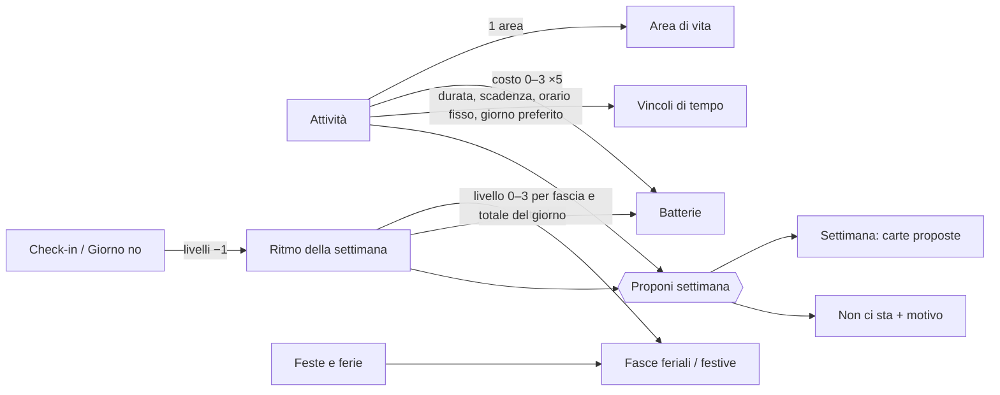

# Priority Planner · piano

Stato al 24/11/2026, versione 0.2.1. Tutti i 20 punti della revisione (rev. 3, 09/11/2026) sono approvati. La roadmap visiva è in `docs/roadmap/` e segue questo piano.

**Adesso:** Fase 1 (T2): modello dati, «Nuova attività», «Tutte le attività» con il filtro.

## Stato del lavoro

| Fatto | # | Fase | Cosa vedi funzionare alla fine | Punti | Tempo indicativo |
|---|---|---|---|---|---|
| ✅ | T1 | 0 | L'app vuota si installa su tablet e Windows, con 4 stili in chiaro e scuro e l'aggiornamento automatico | D1, D2, D5 | ~2 h |
| ⬜ | T2 | 1 | Crei attività con area, batterie e vincoli; vedi «Tutte le attività» con il filtro | A1, A2, C1, C3 | ~1,5 h |
| ⬜ | T3 | 2 | «Il mio ritmo»: pennello, fasce, feste e ferie, ritmi salvati | B1, B2, B3, B6 | ~1,5 h |
| ⬜ | T4 | 3 | Vista Settimana + «Proponi settimana», con attività lunghe e test | A3, B4, B7, B8 | ~3 h |
| ⬜ | T5 | 4 | Vista Oggi, check-in del mattino, «Giorno no» | B5, C1 | ~1 h |
| ⬜ | T6 | 5 | Importa / Esporta, provato tra tablet e telefono | D4 | ~1 h |

I tempi sono stime del lavoro dell'agente. Ogni fase finisce con un APK provato sul tablet e con l'installer Windows.

Già presente nel codice (Fase 0, versioni 0.1.0–0.2.1):
- Progetto Tauri 2 + Svelte + TypeScript, con `versioni.txt`.
- I 4 stili (Liquid glass, Neumorfismo, Skeuomorfismo, Claymorphism) con chiaro e scuro e la finestra «Stile» con Applica / Annulla (`src/lib/aspetto.svelte.ts`).
- La settimana corrente vuota, 7 giorni, con le fasce feriali e festive (`src/lib/fasce.ts`). Per ora sono festivi solo sabato e domenica: l'elenco «Feste e ferie» arriva in Fase 2.
- Legenda di batterie e aree, solo icone (`src/lib/energia.ts`).
- Aggiornamento automatico: all'avvio l'app cerca una release nuova su GitHub e mostra «Aggiorna a vX.Y.Z». Su Windows un clic scarica, installa e riavvia (provato da 0.2.0 a 0.2.1); su Android apre il download dell'APK (`src/lib/aggiornamento.svelte.ts`).
- Build e pubblicazione: `build-android-alt.ps1` (APK arm64), `build-windows.ps1` (installer NSIS con certificato autofirmato e firma dell'updater), `release.ps1` (release GitHub con installer, APK e `latest.json`).

## L'idea in una riga

Ogni attività consuma energia da 5 **batterie**. Ogni giorno ha un livello per batteria in ogni fascia oraria. Il bottone **«Proponi settimana»** mette ogni attività dove le batterie bastano.

## Il modello (A1–A3)

| Concetto | Valori | A cosa serve |
|---|---|---|
| **Area** (1 per attività) | 💼 Lavoro, 👪 Famiglia, 🧡 Amici, 🩺 Salute, 🏠 Casa, 🌱 Me stessa | Colore e icona della carta; alternare le aree nella settimana; filtro Lavoro / Personale |
| **Batterie** (costo 0–3 ciascuna) | 🧠 Mentale, ❤️‍🩹 Emotiva, 💬 Sociale, 🎧 Sensoriale, 💪 Fisica | Decidono **dove** entra un'attività. Nomi e icone si possono cambiare |
| **Vincoli di tempo** | Durata, scadenza, orario fisso, giorno preferito | Decidono **quando** può entrare |

**Cuscinetto** (A3): dopo un'attività con almeno un costo 3, l'app lascia 15 minuti liberi. Si sceglie 0, 15 o 30 minuti.

## Fasce e settimana (B1, B2)

7 giorni. Due modelli di fasce, modificabili nelle impostazioni:

| Giorno | Fasce predefinite |
|---|---|
| Feriale (13) | 7–9, poi ogni ora da 9 a 18, poi 18–20, 20–22, 22–0 |
| Festivo (9) | 6–8, 8–10, 10–12, 12–14, 14:30–16, 16–18, 18–20:30, 21–0, 0–3:30 |

- I buchi 14–14:30 e 20:30–21 sono pause: l'app non ci mette niente.
- La fascia 0–3:30 esiste solo se anche il giorno dopo è festivo: c'è il sabato, non la domenica.
- Sabato e domenica sono festivi. Feste e ferie si aggiungono nell'elenco «Feste e ferie» (data o intervallo, nome facoltativo). Nessuna festa precaricata.

## Il mio ritmo (B3, B6)

- Per ogni fascia e batteria un livello da 0 a 3, colorato con un pennello: scegli la batteria, clicchi le caselle.
- Il **totale del giorno** per batteria vale il 40% della somma delle fasce, ed è modificabile a mano.
- Si salvano più ritmi con un nome (es. «Normale», «Settimana pesante»). Per ogni settimana scegli quale usare. Un ritmo nuovo parte da una copia di uno esistente.

## Il bottone «Proponi settimana» (B4, B7, B8)

1. Mette prima gli impegni a orario fisso e le attività bloccate.
2. Ordina le altre: prima la scadenza più vicina, poi il costo totale più alto.
3. Una fascia accetta un'attività solo se bastano livello, totale del giorno e tempo libero.
4. Al massimo 1 attività pesante emotiva o sociale al giorno (numero modificabile).
5. Tra le fasce valide sceglie quella con più energia libera. Preferisce il giorno preferito e alterna le aree.
6. Ciò che non entra va in **«Non ci sta»**, con il motivo (es. «gio–ven: 💪 finita»).

Attività lunghe (B7):
- Un'attività breve entra in una fascia se c'è tempo libero; più attività brevi possono stare nella stessa fascia.
- Un'attività lunga occupa fasce consecutive e vuote; una pausa interrompe la sequenza.
- Ogni fascia occupata deve avere il livello sufficiente; il costo conta una volta sola nel totale del giorno.
- Nella griglia la carta sta nella prima fascia; le fasce dopo mostrano «↳» con il nome.

Le proposte hanno il bordo tratteggiato. Clic su una carta = la blocchi (🔒, bordo pieno): resta ferma quando chiedi una nuova proposta. Ogni carta dice in una riga «perché qui». Con gli stessi dati la proposta è sempre la stessa.

A fine settimana (B8) le attività non fatte e quelle in «Non ci sta» tornano in «Da pianificare». L'app non cancella mai niente da sola; un contatore neutro dice quante sono.

## Giorno no e check-in (B5)

- **Giorno no**: ogni livello di oggi scende di 1. Le attività di oggi si sbloccano, tranne quelle a orario fisso. L'app ricalcola da oggi a domenica; i giorni passati restano. Le attività spostate hanno un bordo giallo.
- **Check-in del mattino**: 🙂 nessun cambio · 😐 −1 su Mentale ed Emotiva · 😣 Giorno no.

## Le 6 schermate (C1)

1. **Settimana**: la vista principale, griglia di 7 giorni per fasce.
2. **Oggi**: solo «Adesso» e «Dopo», in grande.
3. **Nuova attività**: titolo, area, durata e 5 cursori. I modelli salvati compilano i campi.
4. **Il mio ritmo**: la griglia da colorare con il pennello.
5. **Check-in del mattino**: 3 faccine.
6. **Tutte le attività**: elenco completo con stato (in settimana, da pianificare, non ci sta, fatta), scadenza, filtro e ricerca.

**Filtro** (C3): Tutte · 💼 Lavoro · 🏡 Personale (tutte le aree tranne Lavoro). Vale in Settimana, Oggi e Tutte le attività. È solo visivo: le attività nascoste occupano comunque la fascia, che mostra un segno grigio.

## Scelte visive (C2, D5)

- Solo icone, senza il nome accanto. Il nome compare tenendo premuta l'icona o passandoci sopra, e in una sola legenda.
- Poco testo. Niente rosso da «fallimento»: «Non ci sta» usa toni neutri.
- Nessuna animazione brusca, nessuna notifica insistente.
- Ogni batteria ha un colore suo. Colori e icone restano uguali in tutti e 4 gli stili.

| Stile | In questa app |
|---|---|
| Liquid glass (di partenza) | Pannelli di vetro su uno sfondo di luce sfumata; le icone della legenda sono gocce d'acqua colorata |
| Neumorfismo | Fasce incavate, carte in rilievo, superficie unica senza bordi |
| Skeuomorfismo | Copertina in pelle cucita; la settimana è una pagina d'agenda di carta con doppio margine rosso, rilegatura tra venerdì e sabato, orari a matita; bottoni in ceramica e ottone |
| Claymorphism | Pasta da modellare: sfondo azzurro pastello, riquadri giallo burro, accenti rosa fragola; forme gonfie e opache, al massimo su due livelli |

## Tecnica (D1–D4)

- **App**: Tauri 2 + Svelte + TypeScript. Obiettivo principale il tablet Android in orizzontale; Windows a ogni versione; funziona anche sul telefono.
- **Dati**: file JSON sul dispositivo. Offline, senza account.
- **Pianificatore**: modulo TypeScript separato, con test.
- **Calendari esterni**: nessuno per ora (D3). Gli impegni fissi si scrivono nell'app.
- **Sincronizzazione** (D4): «Esporta» crea un `.json` con tutti i dati, la data e il dispositivo. «Importa» mostra le due date, chiede conferma e sostituisce tutto, dopo una copia di sicurezza dei dati attuali.
- **Aggiornamenti**: release su GitHub (`MrsKugla/PriorityPlanner`), create con `release.ps1`. Non sostituiscono Importa / Esporta: aggiornano l'app, non spostano i dati.
- **Versioni**: SemVer in `package.json`, `src-tauri/Cargo.toml`, `src-tauri/tauri.conf.json`, con `versioni.txt`.
